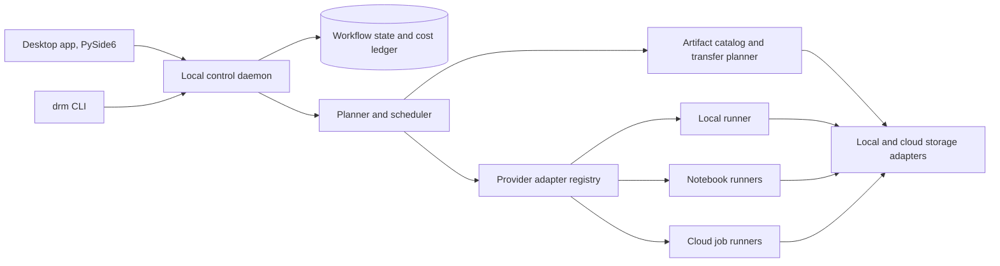

# Distributed Resource Manager

GptCompress compute and storage orchestrator · Design specification · 2026-11-22 · Proposed for implementation

## 1. Purpose and boundaries

Build a desktop application — the **Distributed Resource Manager (DRM)** — that runs GptCompress experiments across local hardware and cloud accounts. The user connects compute and storage providers, sets the experiment budget and data placement rules, and submits a workflow. The app chooses where to run each job, how to divide independent work, which copies of the inputs to read, and where to keep outputs. It re-plans unfinished work when capacity, quota, cost or data availability changes.

The app ships two interfaces over one local control daemon: a **PySide6 desktop application** for interactive use and the **`drm` command-line interface** for scripted and agent-driven use. There is no browser-based interface. Every action available in the desktop app is also a CLI command with machine-readable output (Section 4).

The first workflow targets the pinned original Qwen3-4B teacher and a factorized student. The [data architecture](../../docs/DATA_ARCHITECTURE.md) defines corpus sources, provenance, splits, target formats and research sample sizes. This specification defines execution, placement and recovery. The orchestrator treats each model revision, dataset release, numerical policy and evaluation protocol as part of the experiment. Changing one of these produces a new plan or run revision with an explicit scientific change.

Default policy uses eligible free resources first and favors cloud execution for model-scale work. The existing Windows laptop has a 4 GB RTX 3050 and approximately 16 GB system RAM. The app detects current headroom at runtime and gives the user separate limits for local CPU, GPU, RAM and disk. The experiment's out-of-pocket ceiling is configurable up to the user's stated $10 total, with $7 as a conservative optional paid allocation when the user selects it. A new experiment starts with paid launches disabled. The ceiling includes compute, storage, transfers and charges accrued during retries and cleanup.

## 2. User experience

The desktop application presents the following screens. Every screen action has an equivalent `drm` command so agents and scripts can perform the same operations; Section 4 defines the command contract.

| Screen | What the user can see and do |
| --- | --- |
| Providers | Connect one or more accounts for the same service, give each connection a display name, choose its region, verify credentials, run a capability probe, set quotas/limits, pause or drain an instance, see observed capacity and pricing freshness |
| Data catalog | Find releases, shards, teacher targets and models, inspect checksums and physical copies, pin a copy, define allowed locations, request a copy or free eligible cache space |
| Experiment builder | Select teacher, source release, workflow, factorization scope, quality profile and budget. Preview job dependencies, placement, transfer volumes, expected duration, estimated cost range and blockers |
| Run monitor | See completed and remaining shards, live attempts, resource peaks, reserved and actual spend, failures, planned moves and notebook actions. Pause, resume, cancel or change the budget within the experiment ceiling |
| Results | Compare variants using matched datasets/protocols, see which provider produced each output, and export manifests, metrics and an itemized cost ledger |

The preview explains each major placement decision with concrete evidence, such as a verified model cache that saves a download, a GPU that fits the measured memory peak, or a provider that is waiting for quota. Show expected time as a range when queue or runtime data is weak. A manual notebook action shows the exact run and shard to start and where a validated result will appear. It remains visible until the provider reports success or the output is imported.

## 3. System components



- **Control daemon.** Owns the provider registry, workflow graph, policies, job leases, billing reservations and audit history. Run it as a local background service that exposes a loopback-only JSON API; the desktop app and the CLI are clients of the same daemon, and SQLite is the transactional store for a single coordinator. Back up the database and export immutable run manifests. Automated scheduling pauses while the coordinator is offline. Already submitted bounded jobs can finish and persist outputs remotely. Reconcile them on reconnect. A hosted coordinator is a later deployment option if unattended scheduling becomes necessary.
- **CLI.** The `drm` command is the canonical machine-facing interface. It covers every query and mutation the daemon supports, emits stable JSON, and is safe for AI agents under the spending policy. Its contract is defined in Section 4.
- **Worker runtime.** Runs a versioned Python command or container where supported. It reads a job manifest, probes resources, stages verified inputs, executes a bounded operation and writes a result manifest. Use the same task code across providers, with notebook wrappers for environments that require them. A worker can transfer artifacts directly to another approved provider. Large files need not pass through the laptop.
- **Provider registry.** Separates the adapter type from configured provider instances. Two accounts on the same service appear as two provider instances and are independently selectable by the scheduler. Each instance has a stable ID, display name, account identity, credential reference, scope and region where applicable, capabilities, health and limits. Adding an account, bucket, machine or region is a configuration action. A new service with a different API requires a reviewed adapter implementing the versioned contract. Existing workflows refer to capabilities and policies rather than provider names.
- **Artifact catalog.** Maps logical releases and artifacts to verified physical copies. It tracks origin, usage, placement and rebuild information. Compute and storage capabilities can be configured independently even when they belong to one provider.

## 4. CLI contract

The CLI is a first-class interface, not a wrapper around the desktop app. The binary name `drm` is the short form of the app name; a `drmgr` alias can be shipped alongside if disambiguation from the digital-rights acronym is ever needed.

1. **Grammar.** `drm <resource> <verb> [arguments]`. Resource and verb pairs mirror the screens: `drm providers connect|probe|pause|drain`, `drm data ingest|pin|evict|list`, `drm plan preview <experiment>`, `drm run submit|pause|resume|cancel`, `drm budget set <amount>`, `drm jobs retry <id>`, `drm wait <operation-id>`, `drm explain <decision>`.
2. **Machine-readable output.** Every command accepts `--json` and emits one versioned JSON document carrying a `contract` field. Human mode prints tables; JSON mode never embeds prose that a consumer must parse.
3. **Stable exit codes.** `0` success; `1` unexpected error; `2` blocked by policy, budget cap or failed validation; `3` awaiting user action (assisted provider step); `4` reconciliation required after an ambiguous provider outcome. Agents branch on exit codes without reading prose.
4. **Dry runs.** Every mutating command accepts `--dry-run` and returns the placement plan, estimated cost range and blockers without dispatching anything. Preview long or paid operations before submission.
5. **Idempotency.** Every mutating command accepts or derives an idempotency key. Retrying a command with the same key returns the original operation instead of creating a duplicate. This is the CLI expression of the reconcile-before-retry rule in Section 9.
6. **Blocking waits.** `drm wait <operation-id> --timeout <seconds>` blocks until the operation reaches a terminal state and returns its final record, so agents avoid poll loops.
7. **Decision transparency.** `drm explain <decision>` replays the planner's recorded decision inputs and alternatives for a placement or plan change — the same evidence shown in the desktop preview.

Example — ingest a dataset and let the app handle classification, placement and verification:

```bash
$ drm data ingest hf://datasets/<owner>/<corpus> --release calib-v1 --verify --json
{"contract": 1, "job": "ing-7f2a", "status": "queued"}
$ drm wait ing-7f2a --timeout 3600
{"contract": 1, "job": "ing-7f2a", "status": "complete",
 "artifact": "calib-v1",
 "copies": [{"provider": "hf-private", "sha256": "9f1c…", "state": "durable"}]}
```

The command registers the logical artifact, classifies it, selects an approved store, stages and checksums the bytes, and updates the catalog. Failure returns a nonzero exit code and a JSON error record stating the blocking reason.

## 5. Provider contract and onboarding

| Interface | Required behavior |
| --- | --- |
| `discover` and `probe` | Report account/session eligibility, accelerator type and count, VRAM per device, supported precisions and operations, CPU/RAM/disk, queue and session limits, concurrency, network reachability and quota. Record timestamps and distinguish advertised values from observations |
| `quote` | Return currency, quote expiration, billing increments, known compute/storage/transfer/request prices, credit eligibility, available credits and upper cost estimates with their assumptions. Represent unknown values explicitly |
| `submit`, `status`, `cancel` | Return an external attempt ID or manual launch instructions. Use a stable request ID where available. Report cancellation support and confirmation. On an ambiguous submission, reconcile before retrying |
| `list_usage` | Read usage and invoice/balance events where supported. Report settlement delays and expose unverified manual entries separately |
| `head`, `read`, `write`, `list`, `delete` | Inspect, stream or copy artifacts, verify version/size/checksum, and expose supported atomicity, ranged reads, multipart transfer, lifecycle and encryption options. `delete` acts on specific copies after catalog checks |

Providers declare `api`, `assisted` or `manual` execution, plus capabilities such as public internet, inbound connectivity, partial output export, remote cancellation, persistent disks, interruptible capacity and co-located storage. Unsupported features stay unavailable in the planner. A profile becomes schedulable after a credential check and a small runtime or storage probe. Prices, capacity and quota refresh independently. A stale paid quote or unverified network route prevents that candidate from being auto-selected until refreshed.

For example, `Kaggle / Account A` and `Kaggle / Account B` use the same adapter but are distinct scheduling candidates. Probe each connection independently and track quotas, credits and charges at their actual account, project, organization or billing scope. Connections that share an allowance must reserve against the same pool. Parallel dispatch across accounts is eligible only when the provider permits it. Artifact access is checked per connection, so access to one account's private data requires an authorized share or transfer for another account. All instances draw against the same experiment spending ceiling.

Credentials are referenced by ID and kept in a credential store or injected through a provider's secret mechanism. Give runners access only to their input and output locations where the provider supports that scope. Keep credentials out of job manifests, logs and notebook outputs. Manual adapters import only declared result files and validate them like managed attempts. Register allowed adapter implementations locally and constrain workers to the app's versioned task types.

### Initial provider profiles

| Provider | Proposed integration and operating limits |
| --- | --- |
| Local machine | Process runner and filesystem store. Probe free RAM, disk and VRAM. Run small checks, coordinator duties or CPU preparation within the user's limits |
| Hugging Face Hub | Default persistent store for private dataset/model releases and manifests. Track account usage and existing file versions. Fetch pinned public upstream weights directly into approved cloud scratch. Free private allowance was documented as 100 GB at design time. [Storage limits](https://huggingface.co/docs/hub/en/storage-limits) |
| Kaggle | Notebook runner. Start with assisted submission and import, then enable official CLI submission/status/output for accounts and features proven to work. Support attached private datasets when outbound access is unavailable. Only schedule parallel sessions when the verified account policy permits them. Confirm GPU, duration, quota and output persistence before using a job shape. [Notebook documentation](https://www.kaggle.com/docs/notebooks), [official CLI](https://github.com/Kaggle/kaggle-cli/blob/main/skills/references/kernels.md), [private datasets](https://www.kaggle.com/docs/datasets) |
| Google Colab | Assisted standalone notebook execution. The app prepares an independent task bundle and can import its validated result. Free runtimes stay outside automatic worker pools and distributed execution per Colab's restrictions. Check actual access and lifetime at launch. [Colab FAQ](https://research.google.com/colaboratory/faq.html) |
| Modal | Managed batch execution with bounded job duration and concurrency. Use it for tasks whose measured memory or runtime favors this route. Include startup, CPU, RAM and applicable storage in quotes. Reconcile provider-side retries and enforce a workspace spending limit where available. [Pricing](https://modal.com/pricing), [budgets](https://modal.com/docs/guide/budgets), [preemption](https://modal.com/docs/guide/preemption) |
| Cloudflare R2 or another supported object store | Optional shared durable storage using private bucket access. Quote request and storage costs independently of egress. Enable this profile only when the placement plan benefits from it. [R2 pricing](https://developers.cloudflare.com/r2/pricing/) |
| Google Cloud | Optional VM and object-storage profiles. GPU scheduling requires verified paid billing status, quota, availability and credit applicability. Trial CPU/storage use can be quoted separately. [Free program](https://docs.cloud.google.com/free/docs/free-cloud-features), [GPU quotas](https://docs.cloud.google.com/compute/docs/gpus/about-gpus) |
| Lightning AI, Runpod, Vast.ai | Candidate extensions using assisted runs or supported APIs. Verify account offer, actual selected hardware, total checkout cost, storage lifetime and cancellation. Rental credit balance alone is insufficient as a cost bound. [Lightning pricing](https://lightning.ai/pricing), [Runpod billing](https://docs.runpod.io/accounts-billing/billing), [Vast billing](https://github.com/vast-ai/docs/blob/main/guides/reference/faq/billing.mdx) |

These profiles describe integration choices. The live registry reads or accepts confirmed limits from the actual account. Manual profiles remain useful when an API cannot expose quota, cancellation or GPU selection.

## 6. Data placement and retrieval

Each artifact has a logical ID, content hash, type, byte count, format/schema, parents, producer and split identity. The catalog records each physical copy with provider, locator, immutable version, checksum, status, access class, retention policy and whether it is durable, staged or rebuildable. A manifest points to logical IDs and hashes. The scheduler resolves copy locations when an attempt starts.

1. **Classify the artifact.** Keep upstream public references, licensed source snapshots, released private data, experiment results and disposable caches distinct. Respect source terms, approved providers, privacy and residency requirements. Keep the original split attached to all derived data.
2. **Select durable storage.** Choose among permitted stores based on cost over the expected retention period, quota headroom, reliability, access from candidate compute providers and the cost of repeated downloads. Store canonical releases and required checkpoints on a durable approved store. Kaggle scratch, Colab runtime disks and rental volumes are treated as disposable unless their persistence and retention have been explicitly verified.
3. **Select a read route.** Prefer a verified available copy with the best combined transfer time, cost and reliability. Include source egress, destination transfer fees, requests and temporary copies. Co-locate jobs with frequently reused large inputs when that reduces total time/cost. A cross-provider route needs a demonstrated network path. Block or select another route if staged inputs and peak outputs cannot fit.
4. **Stage and validate.** Download by ranges or resumable multipart operations when supported. Verify full content identity before the runner reads it. Upload to an attempt location, verify checksums and publish the manifest only after every required artifact is readable. Use conditional writes where available and a coordinator transaction to accept one result per logical shard.
5. **Replicate or evict.** Add a replica if it reduces expected repeat transfers or meets the run's durability policy. Account for both copies during migration. Evict disposable copies after checking references, active leases and retained reproducibility dependencies. Retain a verified durable copy for pinned or required artifacts. Budget only policy-approved retention and record outstanding recurring costs.

Keep **manifests, cleaned shards, selected supervision, factors and reproducible checkpoints**. Accumulate activation statistics during inference and write bounded statistics or sketches. For reference, 10M full FP16 logit vectors at vocabulary size 151,936 occupy about 3.04 TB. A top-64 cache with 32-bit IDs and 16-bit values is about 3.84 GB plus metadata for the same positions, with an approximate training objective. Job profiles choose among local statistics, compact targets and recomputation based on measured transfer and compute economics. [Qwen3-4B configuration](https://huggingface.co/Qwen/Qwen3-4B/raw/main/config.json)

## 7. Planner and scheduling policy

Represent an experiment as a directed acyclic graph. Each task specifies dependencies, partitioning strategy, artifact IDs, numerical compatibility, resource floor and estimated peak, checkpoint granularity, maximum attempts, timeout and output format. Each shard covers explicit example IDs, token positions, layers or matrices. Work units carry unique IDs. A group of shards may share one session when it amortizes model loading and respects checkpoint and time limits.

1. **Probe and filter.** Check CPU RAM, VRAM per device, scratch/persistent disk, supported kernels/precision, model and optimizer working sets, session duration, quota, network, privacy and spend. Sum GPU memory across devices only for a workload with verified explicit model sharding. Check cold-start and checkpoint time against the session deadline.
2. **Generate candidates.** For each eligible compute placement, consider usable input replicas, staging routes, output destinations and shard sizes. Estimate wall time from queue, setup, data staging, measured work throughput and checkpoint/upload. Estimate cash from billable time, storage duration, ingress/egress and operations, including applicable credits and bounded retry scenarios. Keep token, generation, calibration-statistic and training throughput separate.
3. **Choose the plan.** By default, exclude candidates that cannot meet hard constraints, choose a plan with lower estimated cash cost, then prefer earlier completion and fewer bytes moved among similarly priced choices. If a deadline is configured, prefer candidates estimated to meet it and show uncertainty. Make planning tradeoffs visible when a faster placement costs more. Reserve quota and budget globally for concurrent jobs, then place dependency-ready shards on the critical path. Use a deterministic tie-break. A greedy planner with later correction is adequate for the first implementation. Record the decision inputs and alternatives for each change.
4. **Partition and dispatch.** Balance by token length and expected work rather than row count. Each worker can handle independent windows or prompts with a full teacher copy where memory allows. Send only the assigned inputs plus pinned model/code identifiers. Batch similar lengths within numerical and memory limits. Split an oversized task only if it declares a valid partition/merge strategy.
5. **Re-plan unfinished work.** Trigger on quota changes, worsening price or availability, stalled jobs, missing or invalid copies, out-of-memory, expired sessions and observed throughput changes. Use completed outputs and valid checkpoints. OOM leads to a smaller supported microbatch, smaller legal shard or higher-memory hardware. Changed context length, numerical policy or training semantics require a new explicitly selected scientific profile. If no eligible placement exists, leave jobs queued with the specific resource or policy reason.

Bootstrap with a representative bounded benchmark per hardware and workload profile. Record usable VRAM and scratch, per-token or per-matrix throughput, setup/model load, peak memory, checkpoint size/time and time to restore. Keep performance observations keyed by hardware, precision, sequence length, batch size, software stack and operation. Update estimates as real attempts complete. For example, at 500 processed tokens/second, a 5M-token teacher pass alone takes about 2.8 hours, excluding setup, retries, training and evaluation. This is arithmetic for planning. The real run supplies the rate.

## 8. Qwen3 workflow and parallelism

| Stage | Unit of work | Combine outputs |
| --- | --- | --- |
| Collection and extraction | Source shard or bounded crawl assignment | Merge source manifests and run global duplicate/benchmark checks before publishing grouped splits |
| Calibration input capture | Fixed calibration sequence shard, optionally a declared module/layer group | Merge statistics in a fixed shard order, validate compatible schema and arithmetic and verify exact input coverage |
| Factorization | Matrix or layer with complete statistics and frozen rank/configuration | Publish factors under original tensor identifiers, then assemble the student and verify save/reload |
| Teacher answer generation | Independent prompt IDs, grouped by mode/length | Preserve prompt ancestry, seed/settings and finish reason. Validate, deduplicate and index by prompt ID |
| Teacher forcing | Independent fixed sequences and supervised positions | Validate tokenizer, position alignment and target representation. Index targets by sequence ID and exact cache identity |
| Distillation recovery | Sequential student checkpoint chain by default. Allow independently declared block-local fits on frozen inputs when the experiment supports them | Resume from compatible model/optimizer/RNG/data cursor state. Merge independent factors only under a declared rule and rerun end-to-end evaluation |
| Evaluation | Benchmark task shard with frozen question IDs and protocol | Merge exact example IDs and recompute benchmark-native metrics. Report incomplete coverage and harmonize numerical profiles |

For **input-aware factorization**, the worker runs a forward pass over the chosen token sequences and records inputs to the relevant projections. In an exact second-moment implementation, each shard can return the unnormalized sum `G_s = X_s X_s^T` and the count of valid tokens. The reducer sums `G_s` and counts once per shard, then applies normalization and configured damping. The representation and memory budget are declared per layer group. A sketch must specify its own merge contract. Down and up projections require their own verified input capture points. Teacher answer generation is a separate step that can provide representative assistant continuations when the calibration mix calls for them. The forward pass supplies the activation statistics.

Independent shards can run side by side on compatible providers. Each receives the same pinned model, tokenizer, template and capture or decoding configuration. Record actual precision, kernels, devices and seeds. Require a small cross-provider numerical comparison before pooling results from different runtime profiles, with tolerances defined for that workload. Do not aggregate outputs across incompatible profiles. If layer reconstruction uses upstream compressed activations, encode those dependencies so later layers wait for the required prefix. Global training uses one coherent student checkpoint sequence. Combining independently trained whole-model weights would change the method and requires a separate experiment.

For the first run, validate the small pipeline smoke profile, then aim for roughly 1M calibration tokens and 5–10M unique recovery tokens only after measuring cost and fit. Keep existing external benchmarks separate and lock final holdouts. The app reports original, weight-only, input-aware and recovery results at matched compression budgets and evaluation settings. Use per-capability results to assess retention.

For example, the planner could place eight calibration shards across two verified sessions, four per session, keep each completed shard's statistics in private durable storage, and start the reducer after all eight results validate. If the second session expires after saving three of its four assigned work units, the coordinator schedules only its missing unit and reads the other results from storage. If only one session is allowed, it runs the same plan sequentially. If a later factor solve needs more memory than those sessions offer, it can use an eligible credited job or wait with the measured memory shortfall displayed. Any placement change preserves the workflow's input identities and numerical policy.

## 9. Spending controls and recovery

Maintain a single experiment ledger with quoted cost, reserved worst-case cost, provisional usage, settled cash charges, provider credits, free quota consumption and recurring obligations. Credit balances have provider/account scope, application rules and expiration. Use conservative exchange rates and taxes when relevant. Reserve funds transactionally before submit. Do not add settled charges and active reservations for the same usage twice. Hold the reservation until cancellation, settlement or reconciliation establishes what remains payable. Preserve the experiment cap across calendar and provider billing cycles.

Automatically launch paid work only if the user has enabled it for the run, the provider has enforceable or credibly bounded charges for every resource involved, and the ledger can reserve the upper bound without exceeding the experiment ceiling. Unknown charges, minimum deposits beyond the cap, or resources that could keep billing unbounded exclude a route from automatic paid use. Use provider limits where available, one-time capped work orders, explicit timeouts and reserve headroom for late invoices and cleanup. Tracking estimates and alerts alone cannot guarantee the ceiling. Standing storage has a defined retention window and budget reservation. The UI reports remaining liability after job completion.

Jobs move through `queued`, `staging`, `ready`, `running`, `validating`, `complete`, `retry_pending`, `failed` or `cancelled`. Assisted execution also exposes `awaiting_user`, and an unknown provider outcome exposes `reconciling`. Store provider attempt ID, lease and heartbeat if supported. Use at-least-once execution with exactly one accepted output per logical shard. On ambiguous provider submission or cancellation, reconcile the provider state before launching a duplicate. Drop stale or invalid result manifests from the completion path while retaining diagnostics.

A pause stops new dispatches and shows work still running. Cancel requests remote stop where supported, records the acknowledgement, preserves the latest verified checkpoint, and accounts for disks or volumes still accruing charges. If a provider cannot cancel automatically, surface the manual action and keep associated cost reserved. Checkpoints include the job/run revision, completed work cursor, numerical policy, seeds, model/optimizer state as applicable and hashes. Test resume from a clean environment. Release quota only when a worker is confirmed terminal or the provider confirms the allocation has ended.

## 10. First implementation and acceptance

| Delivery slice | Evidence of completion |
| --- | --- |
| Local control plane and catalog | Register a local runner and two storage locations, preview a plan, store/retrieve a verified artifact, restart the coordinator and recover state, and perform the same flow through `drm` with JSON output and stable exit codes |
| One free cloud route | Connect Hugging Face private storage and Kaggle assisted execution, submit a bounded private task bundle, import remote output, and recover from a missing scratch session using a durable checkpoint |
| Automated placement | Add a second compatible backend and two accounts on one adapter without changing workflow definitions. Show that both accounts are independently selectable, distinct allowances are tracked separately, and shared limits are counted once. Verify placement when memory, cache location, cost or quota differ |
| Safe parallel execution | Execute two disjoint shards across eligible backends, validate IDs and merge matches to a same-profile reference. Inject interruption, duplicate results and corrupt transfers. Resume only unfinished shards and accept one output per shard |
| Cost controls | Test with simulated credit expiry, stale quotes, late charges, concurrent reservations and a provider that cannot bound storage costs. Show that the planned $10 cap survives an app restart and that unsafe paid routes remain unlaunched |
| Real Qwen3 smoke run | Capture representative activation statistics, factorize a bounded subset of real matrices, write a verified factor artifact, and run matched diagnostics. Demonstrate a small recovery task with documented memory, throughput, storage and costs before scaling |

Use a portable task manifest, provider adapter contract and mock providers for failure tests before relying on a real account. Build the first release around Local, Hugging Face and Kaggle, and add the Modal adapter for automated higher-memory batches once the free route works. The desktop shell is PySide6; the daemon exposes its JSON API on loopback only; the CLI is a thin client of the same API. Exact final placement scoring weights, account entitlements and measured throughput remain implementation decisions. This document is the app design. It records no provisioning, uploads, billing changes or measured cloud runs.
